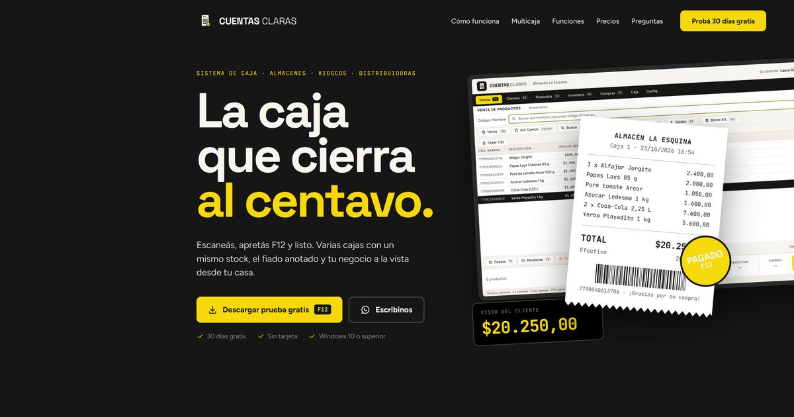

  
  
  

## 👋 Hola, soy Bruno

Desarrollador **full stack orientado a producto**. Me gusta agarrar un problema real y llevarlo hasta que alguien lo use todos los días: la interfaz, la API, la base de datos, el deploy y lo que pasa después.

- 🚀 Ahora estoy construyendo **[Cuentas Claras](https://brunodistaulo.github.io/CuentasClaras/)**, un sistema de caja que ya usan comercios reales.
- 💼 Trabajé en equipos de producto con **React y TypeScript**: design systems, mobile, i18n, pagos.
- 🤖 Desarrollo con **IA como herramienta diaria** (Claude Code) sin perder el criterio técnico.
- 📫 Abierto a propuestas: [brunodistaulo03@gmail.com](mailto:brunodistaulo03@gmail.com)

---

## 🧾 Proyecto destacado: Cuentas Claras

**Sistema de punto de venta para almacenes y kioscos.** Lo diseñé, lo construí y lo opero solo, y está en producción con clientes.

| | |
|---|---|
| 🖥️ **App de escritorio** | Electron + React + Tailwind, pensada para usarse con teclado y lector de códigos |
| ⚙️ **Backend** | NestJS con 20 módulos, PostgreSQL + Prisma, varias cajas sincronizadas en tiempo real con Socket.io |
| 🧾 **Facturación** | Factura electrónica integrada con ARCA |
| 💳 **Cobros** | Suscripciones mensuales con Mercado Pago (webhooks) y licencias por negocio |
| 🔒 **Multi-tenant** | Cada negocio aislado del resto, con pentest propio |
| 🛠️ **Operación** | Staging y producción, CI/CD con GitHub Actions, instalador que se actualiza solo, backups diarios cifrados, Sentry y UptimeRobot |
| 🎬 **Lanzamiento** | Landing, videos demo hechos con Remotion y prueba gratis de 30 días |

~68 mil líneas de TypeScript en un monorepo con pnpm. El código es privado; la landing y el instalador son públicos.

---

## 💼 Experiencia

| Rol | Dónde | Qué hice |
|---|---|---|
| **Fundador y dev full stack** | Cuentas Claras · 2026 – hoy | El producto completo, de la base de datos a la venta |
| **Frontend Developer** | MaylandLabs · 2025 – 2026 | Yunta, SaaS ganadero: design system, versión mobile, i18n (es/en/pt), flujos de pago |
| **Frontend Developer** | La Esmeralda Café · 2026 | Ecommerce y panel admin en Next.js: productos con variantes, pedidos con QR, facturación |

---

## 🧰 Stack

   
   
  

  
  
  
  

